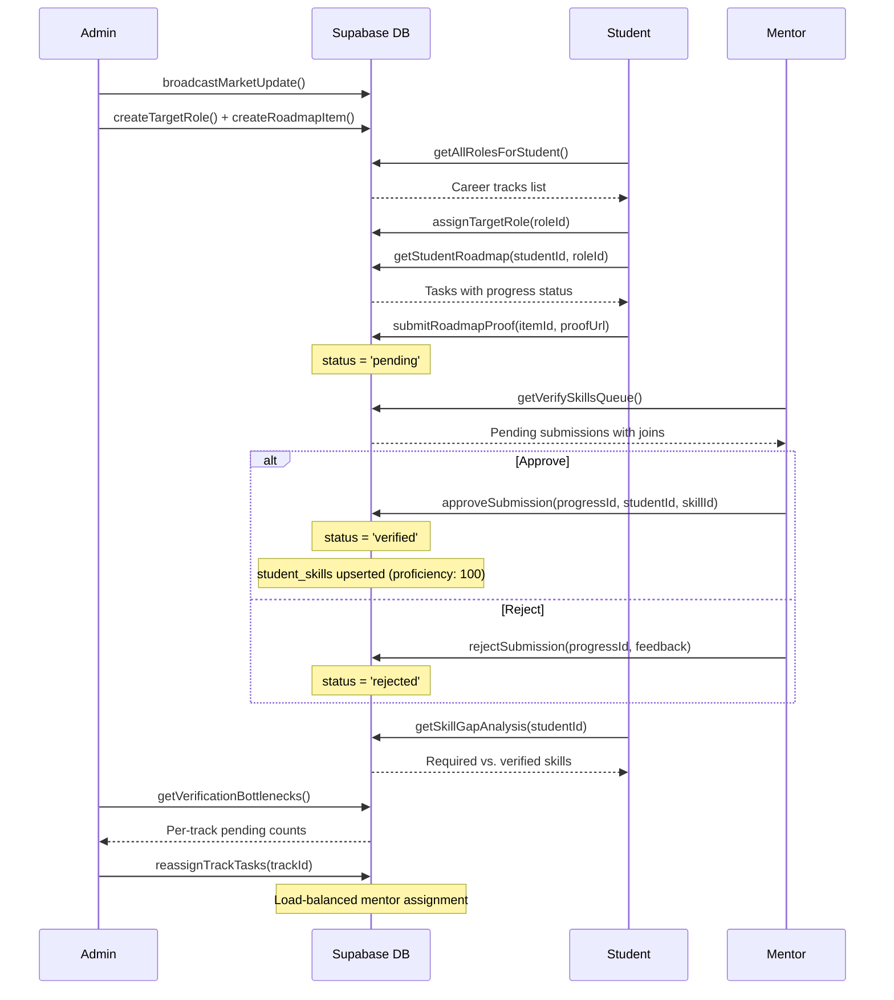

# MarketReady — Comprehensive Project Overview

> **"Don't Just Graduate. Be Market Ready."**

MarketReady is a full-stack education platform that bridges the gap between academic curricula and real-world job market demands. It creates a closed-loop system connecting three stakeholders — **Admins (CDC)**, **Mentors**, and **Students** — around real-time market intelligence, structured learning roadmaps, and mentor-verified skill acquisition.

---

## 1. Problem Statement & Novelty

### The Problem
Traditional college curricula are static and lag behind the rapidly changing tech industry. Students graduate without knowing which skills employers actually need, mentors have no structured way to validate student work, and administrators lack visibility into batch-wide skill readiness.

### The Novelty — "Skill-Awareness Ecosystem Architecture" (SAEA)
MarketReady introduces a **closed-loop skill pipeline** that is unique in the ed-tech space:

```
Admin broadcasts Market Update → generates Roadmap Tasks with linked Skills
     → Student follows Roadmap & submits Proof-of-Work
          → Mentor verifies the submission → Skill is marked as Verified
               → Skill Gap Analysis updates in real-time
                    → Admin sees Batch Readiness & Bottleneck analytics
```

This is **not** a static LMS. Every skill is:
1. **Market-linked** — tied to a `market_skills` entry with demand data
2. **Roadmap-bound** — attached to a verifiable task with instructions
3. **Mentor-verified** — no self-reported skills; only mentor-approved completions count
4. **Analytics-visible** — admins see real-time batch-wide readiness scores and bottlenecks

---

## 2. Tech Stack

| Layer | Technology | Purpose |
|-------|-----------|---------|
| **Framework** | Next.js 16 (App Router) | Server Components, Server Actions, Route Groups |
| **Language** | TypeScript 5 | Type-safe codebase |
| **UI** | React 19, Tailwind CSS 4, shadcn/ui | Component library + utility-first styling |
| **Animations** | Framer Motion | Landing page & UI micro-animations |
| **Icons** | Lucide React | Consistent icon system |
| **Forms** | React Hook Form + Zod | Client-side validation |
| **Charts** | Recharts | Data visualization (admin analytics) |
| **Database** | Supabase (PostgreSQL) | Auth, RLS, real-time, server-side client |
| **Auth** | Supabase Auth | Email/password + Google OAuth |
| **Deployment** | (Configurable) | `next build` / Vercel-ready |

### Architecture Pattern
- **Server Components** fetch data (no `useEffect` / `useState` for loading)
- **Server Actions** (`"use server"`) handle all mutations — no REST API routes needed
- **Client Components** only used where interactivity is required (forms, filters, modals)
- **Middleware RBAC** — role-based route protection at the edge

---

## 3. Database Schema (Supabase / PostgreSQL)

### Core Tables

| Table | Purpose | Key Columns |
|-------|---------|-------------|
| `auth.users` | Supabase Auth (built-in) | `id`, `email` |
| `profiles` | User metadata | `id` (FK→auth.users), `email`, `role`, `full_name` |
| `users` | Extended user view | `id`, `role`, `full_name` (used by middleware) |
| `target_roles` | Career tracks (e.g., "AI Engineer") | `id`, `name`, `required_skills` (JSON), `market_demand_score` |
| `market_skills` | Global skill registry | `id`, `name`, `category`, `is_hot` |
| `market_updates` | Admin broadcast posts | `id`, `title`, `content`, `category`, `posted_by` |
| `roadmap_items` | Curriculum tasks per track | `id`, `target_role_id`, `task_instruction`, `skill_id`, `resource_link`, `is_verified_task` |
| `roadmaps` | Roadmap containers | `id`, `title`, `mentor_id` |
| `student_target_roles` | Student↔Track assignment | `student_id`, `role_id` (unique per student) |
| `student_progress` | Task completion tracking | `id`, `student_id`, `roadmap_item_id`, `skill_id`, `status`, `proof_link`, `mentor_feedback`, `assigned_mentor_id` |
| `student_skills` | Verified skill records | `id`, `student_id`, `skill_id`, `proficiency`, `verified_at` |
| `verifications` | Skill claim verifications | `id`, `student_id`, `skill_id`, `proof_link`, `status`, `mentor_comment` |

### Key Relationships
```
target_roles ──1:N──▶ roadmap_items ──1:N──▶ student_progress
                          │                        │
                          ▼                        ▼
                     market_skills          student_skills
                                                   │
                                              (proficiency %)
```

### Database Functions (RPC)
- **`get_track_bottlenecks()`** — Aggregates pending verification counts per career track, flags tracks with >20 pending as "overloaded"
- **`grant_skill_on_verification`** (DB Trigger) — Auto-inserts into `student_skills` when `student_progress.status` changes to `'verified'`

---

## 4. Authentication & Authorization

### Auth Flow (`lib/actions/auth.ts`)
| Action | Function | Description |
|--------|----------|-------------|
| Login | `login()` | Email/password → Supabase Auth → role-based redirect |
| Register | `signup()` | Creates `auth.users` entry + `profiles` row with role |
| Google OAuth | `signInWithGoogle()` | OAuth redirect flow via Supabase |
| Logout | `logout()` | Signs out, redirects to landing page |

### Middleware RBAC (`middleware.ts`)
Edge-level role enforcement:
- Fetches `users.role` for the authenticated user
- Routes `/student/*` → only `student` role
- Routes `/mentor/*` → only `mentor` role  
- Routes `/admin/*` → only `admin` or `cdc_admin` role
- Unauthorized access → redirect to role's home page

---

## 5. User Roles & Functionality

---

### 5A. 🎓 Student Dashboard

**Sidebar Navigation:** Market Feed → My Roadmap → Skill Gap Analysis → Target Roles

#### Page: Market Feed (`/student/feed`)
- **Server Action:** `getMarketFeed()` — fetches all `market_updates` with author name joins
- **What it does:** Displays admin-broadcast industry updates (hiring trends, tech shifts)
- **Backend wiring:** `market_updates` table → `users:posted_by` join for author name

#### Page: Target Roles (`/student/saved`, `/student/roles`)
- **Server Actions:**
  - `getAllRolesForStudent()` — lists all `target_roles` sorted by demand score
  - `assignTargetRole(roleId)` — upserts into `student_target_roles` (one role per student)
  - `getStudentCurrentRole()` — reads current assignment
- **What it does:** Student picks a career track (e.g., "AI Engineer"), which unlocks the corresponding roadmap
- **Backend wiring:** `target_roles` table → `student_target_roles` (upsert on `student_id` conflict)

#### Page: My Roadmap (`/student/roadmap`)
- **Server Actions:**
  - `getStudentRoadmap(studentId, roleId)` — fetches `roadmap_items` for the chosen track with `student_progress` join
  - `submitRoadmapProof(roadmapItemId, proofUrl)` — inserts/updates `student_progress` with status `'pending'` and the proof link
- **What it does:** Shows task cards with instructions, resource links, and completion status. Students click "Submit Claim" → enter a GitHub/portfolio URL → task enters the mentor verification queue.
- **Backend wiring:** `roadmap_items` → `student_progress` (insert or update), also resolves `skill_id` from the roadmap item for later skill tracking

#### Page: Skill Gap Analysis (`/student/progress`)
- **Server Actions:**
  - `getSkillGapAnalysis(studentId)` — fetches the student's target role's `required_skills` JSON, then their `student_skills` + verified `student_progress` entries
  - `getHotSkills()` — fetches trending skills from `market_skills`
- **What it does:** Visual gap analysis comparing required skills vs. verified skills with proficiency percentages. Shows which skills are missing and which are verified.
- **Backend wiring:** `target_roles.required_skills` (JSON) compared against `student_skills` + `student_progress(status=verified)` merged data

---

### 5B. 👨‍🏫 Mentor Dashboard

**Sidebar Navigation:** Dashboard → Verify Skills

#### Page: Dashboard (`/mentor`)
- **Server Actions:**
  - `getPendingVerifications()` — fetches `student_progress` where `status='pending'` with student name and task instruction joins
- **What it does:** KPI cards (Pending Queue count, Batch Market Score, At-Risk Students) + a table-style verification queue with Approve/Reject buttons + Activity feed placeholder
- **Backend wiring:** `student_progress` → joins `users:student_id` and `roadmap_items` → `resolveRoadmapTask()` for approve/reject

#### Page: Verify Skills (`/mentor/verify`) ⭐ *Newly Implemented*
- **Server Actions:**
  - `getVerifySkillsQueue()` — rich query joining `student_progress` → `profiles`, `roadmap_items` → `target_roles`, `market_skills`
  - `approveSubmission(progressId, studentId, skillId)` — sets status to `'verified'`, upserts `student_skills` with `proficiency: 100`
  - `rejectSubmission(progressId, feedback?)` — sets status to `'rejected'` with mentor feedback
- **What it does:** Split-screen workspace:
  - **Left panel:** Scrollable submission list with student avatars, task titles, relative timestamps
  - **Right panel:** Full review — student info, task instructions, proof link (clickable), feedback textarea, Approve/Reject buttons with loading states
  - **Filters:** Search by student name, filter by Track dropdown, filter by Skill dropdown
- **Backend wiring:** `student_progress` with 4 joined tables → `startTransition` → Server Actions → `revalidatePath` for instant UI updates

---

### 5C. 🏛️ Admin Dashboard (CDC)

**Sidebar Navigation:** Overview → Posts → Analytics

**Note:** The admin section uses a separate route group (`app/admin/`) with its own layout and auth guard (`requireAdmin()` checks `users.role` for `'admin'` or `'cdc_admin'`).

#### Page: Overview (`/admin`)
- **Server Actions:**
  - `getVerificationBottlenecks()` — calls `get_track_bottlenecks()` RPC
  - `getMentorWorkloads()` — counts assigned pending tasks per mentor
  - `getRecentBroadcasts()` — fetches recent `market_updates` with auto-cleanup of 30-day-old entries
- **What it does:** 
  - **Batch Readiness** / **Pipeline Health** KPI cards
  - **Track Performance** table with student counts and avg scores
  - **Verification Bottlenecks** section (live data) — shows pending count per track, flags overloaded tracks, enables task reassignment
  - **Recent Broadcasts** table with category badges and author names

#### Page: Market Broadcasts (`/admin/market`)
- **Server Actions:**
  - `broadcastMarketUpdate(formData)` — inserts into `market_updates`, revalidates student feed
  - `deleteBroadcast(id)` — removes a broadcast
  - `getRecentBroadcasts()` — lists all with 30-day auto-cleanup
- **What it does:** Admin creates market intelligence posts (hiring trends, tech shifts) that immediately appear in the student Market Feed

#### Page: Track Management (`/admin/tracks`)
- **Server Actions:**
  - `createTargetRole(formData)` — creates a new career track with `required_skills` JSON and demand score
  - `getAdminTargetRoles()` — lists all tracks
  - `deleteTargetRole(targetRoleId)` — cascade deletes: `student_progress` → `roadmap_items` → `target_roles`
- **What it does:** CRUD for career tracks that students can enroll in

#### Page: Curriculum (Track Operations) (`/admin/track-ops`)
- **Server Actions:**
  - `createRoadmapItem(formData)` — creates a task under a track, auto-creating the linked `market_skills` entry if it doesn't exist
  - `getAdminCurriculumItems(targetRoleId)` — lists tasks per track with skill name joins
  - `getAllSkills()` — lists all `market_skills` for autocomplete
- **What it does:** Admin builds the curriculum — each task has an instruction, resource link, and linked skill. These become the roadmap items students follow.

#### Bottleneck Management & Load Balancing (`lib/actions/reassign.ts`)
- **`reassignTrackTasks(trackId)`** — Fetches all pending tasks for a track, then assigns them to mentors using a **lowest-load-first algorithm**:
  1. Gets all `roadmap_item` IDs for the track
  2. Finds all pending `student_progress` rows
  3. Fetches mentor workloads
  4. Assigns each task to the least-loaded mentor
  5. Batch-updates `assigned_mentor_id` in DB
- **`assignTasksToMentor(trackId, mentorId)`** — Manual override: assigns all pending tasks for a track to a specific mentor

---

## 6. Full Data Flow — End to End



---

## 7. File Structure

```
my-market-app/
├── app/
│   ├── page.tsx                          # Landing page (Framer Motion)
│   ├── layout.tsx                        # Root layout
│   ├── globals.css                       # Tailwind config + theme
│   ├── auth/
│   │   ├── login/page.tsx                # Login form
│   │   └── register/page.tsx             # Registration form
│   ├── (dashboard)/                      # Route group (Shell + Sidebar + Auth guard)
│   │   ├── layout.tsx                    # Auth check → Shell wrapper
│   │   ├── student/
│   │   │   ├── feed/page.tsx             # Market Feed
│   │   │   ├── roadmap/                  # Roadmap (Server + Client components)
│   │   │   ├── progress/                 # Skill Gap Analysis
│   │   │   ├── roles/                    # Role selection
│   │   │   ├── saved/page.tsx            # Target Roles
│   │   │   └── target-roles/page.tsx     # Target role management
│   │   └── mentor/
│   │       ├── page.tsx                  # Mentor Dashboard
│   │       ├── VerificationQueueClient.tsx
│   │       ├── verify/
│   │       │   ├── page.tsx              # Verify Skills (Server Component)
│   │       │   └── VerifySkillsClient.tsx # Verify Skills (Client Component)
│   │       └── batch/page.tsx
│   └── admin/                            # Separate route group (own auth)
│       ├── page.tsx                      # Admin Overview Dashboard
│       ├── market/page.tsx               # Broadcast Management
│       ├── tracks/page.tsx               # Track CRUD
│       ├── track-ops/page.tsx            # Curriculum Builder
│       └── components/
│           └── BottlenecksSection.tsx     # Live bottleneck widget
├── components/
│   ├── dashboard/
│   │   ├── Shell.tsx                     # Layout wrapper (Sidebar + Header)
│   │   ├── Sidebar.tsx                   # Role-aware navigation
│   │   └── Header.tsx                    # Top bar
│   ├── landing/                          # Landing page components
│   │   ├── Navbar.tsx
│   │   ├── Footer.tsx
│   │   └── TerminalWindow.tsx
│   └── ui/                              # shadcn/ui components
├── lib/
│   ├── supabase/
│   │   ├── server.ts                     # Server-side Supabase client
│   │   ├── client.ts                     # Browser-side Supabase client
│   │   └── middleware.ts                 # Session refresh helper
│   ├── actions/                          # All Server Actions
│   │   ├── auth.ts                       # login, signup, logout, Google OAuth
│   │   ├── admin.ts                      # Broadcasts, tracks, curriculum CRUD
│   │   ├── mentor.ts                     # Verification queue, approve, reject
│   │   ├── feed.ts                       # Market feed fetching
│   │   ├── roles.ts                      # Target role selection
│   │   ├── student.ts                    # Student role assignment
│   │   ├── skills.ts                     # Skill gap analysis
│   │   ├── roadmap.ts                    # Roadmap fetching + proof submission
│   │   ├── bottlenecks.ts                # Verification bottleneck analytics
│   │   ├── reassign.ts                   # Load-balanced mentor reassignment
│   │   ├── market.ts                     # Legacy market update creation
│   │   └── userId.ts                     # Auth helper
│   ├── types.ts                          # Shared TypeScript interfaces
│   └── utils.ts                          # Utility (cn helper)
├── middleware.ts                          # RBAC route protection
├── supabase/
│   └── migration_bottlenecks.sql          # DB migration for bottleneck support
└── schema.sql                             # Core profiles table schema
```

---

## 8. Key Design Patterns

1. **Server-First Architecture** — Data fetching in Server Components, mutations via Server Actions. Zero client-side `fetch()` calls.
2. **Role-Based Route Groups** — `(dashboard)` group with shared Shell layout; `admin/` has its own auth guards
3. **Optimistic UI + Revalidation** — Client components use `useTransition` for pending states, Server Actions call `revalidatePath()` to refresh data
4. **Cascading Deletes** — Track deletion cascades through `student_progress` → `roadmap_items` → `target_roles`
5. **Load-Balanced Assignment** — Admin can auto-distribute pending verifications across mentors using a lowest-load-first algorithm
6. **Skill Auto-Creation** — When an admin creates a curriculum task with a new skill name, the system auto-creates the `market_skills` entry
